  <a href="https://thethinkmachine.github.io">
    <picture>
      <source media="(prefers-color-scheme: dark)" srcset="assets/profile.svg" />
      
    </picture>
  </a>

  <a href="https://thethinkmachine.github.io">Blog</a> ·
  <a href="https://huggingface.co/thethinkmachine">Hugging Face</a> ·
  <a href="https://github.com/thethinkmachine?tab=repositories">Repositories</a> ·
  shreyan(dot)chaubey@gmail(dot)com

  <a href="https://thethinkmachine.github.io/writing/convolution-part-1/">
    <picture>
      <source media="(prefers-color-scheme: dark)" srcset="assets/latest-post-dark.svg" />
      
    </picture>
  </a>

